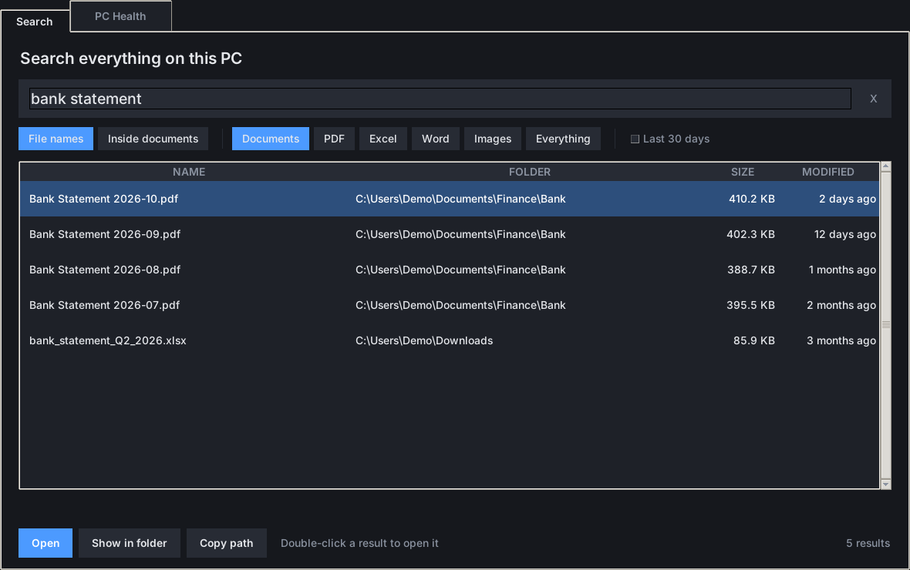
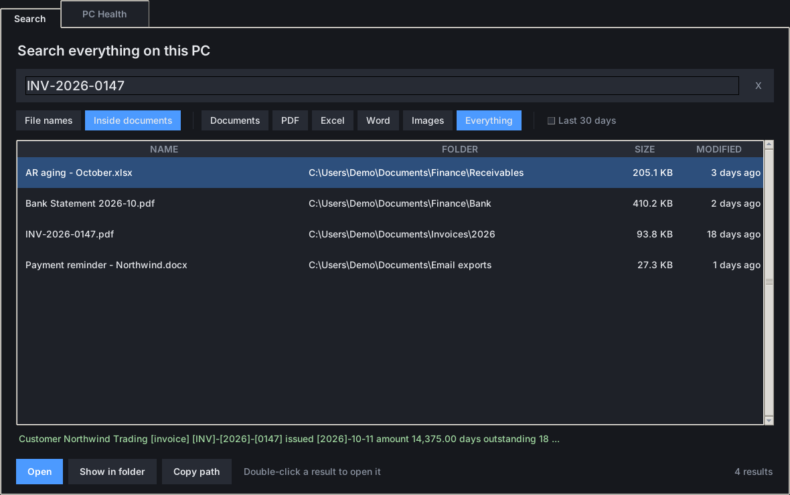
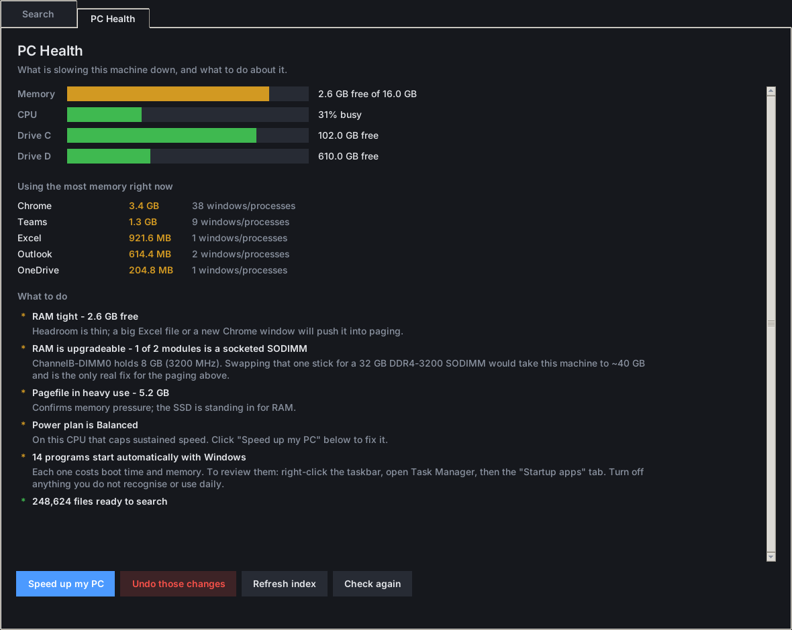

<div align="center">

# ⚡ PULSE

**Find any file on your Windows PC in a keystroke — and see what's slowing it down.**

Press <kbd>Alt</kbd> + <kbd>F</kbd> anywhere.


</div>

<table>
  <tr>
    <td width="50%"><br><sub><b>Search · File names</b> — results as you type, filtered to documents.</sub></td>
    <td width="50%"><br><sub><b>Search · Inside documents</b> — full-text hits in PDF, Excel and Word, with the matching snippet.</sub></td>
  </tr>
  <tr>
    <td colspan="2" align="center"><br><sub><b>PC Health</b> — memory, CPU and disk meters, the heaviest apps, and plain-English fixes.</sub></td>
  </tr>
</table>

<sub>Screenshots use demo data.</sub>

| | Feature | |
|---|---|---|
| ⌨️ | **Global hotkey** | <kbd>Alt</kbd>+<kbd>F</kbd> opens (or re-focuses) the window from anywhere |
| 🔎 | **Instant filename search** | Local SQLite index of every file, ranked as you type |
| 📄 | **Search inside documents** | PDF, Excel, Word and text — Arabic and English |
| 🗂️ | **Quick filters** | Documents · PDF · Excel · Word · Images · Last 30 days |
| 🩺 | **PC Health** | RAM / CPU / disk meters and the apps eating memory |
| 🚀 | **One-click tune-up** | *Speed up my PC* — every change backed up, undo with one click |
| 💻 | **CLI too** | `pulse` and `pulse-tune` for the terminal |

---

## Just open the app

**Press `Alt + F` from anywhere.** Or double-click **PULSE** on your Desktop,
or press `Win` and type `pulse`.

> **Heads-up on Alt+F.** In most Windows programs Alt+F opens the **File**
> menu. While the PULSE hotkey is running it takes `Alt+F` system-wide, so
> File menus in Excel, Word, Explorer and browsers will open PULSE instead.
> You can still reach those menus by pressing `Alt` and then `F`, or by
> clicking **File**.
>
> To change the key:
> ```
> .\hotkey-ctl.ps1 set -Mods ctrl,alt -Key P
> ```
> Or `.\hotkey-ctl.ps1 stop` to turn the hotkey off entirely (the Desktop
> icon keeps working).

That window does everything — no commands needed:

- **Search tab** — type, and results appear as you go. Switch between
  *File names* and *Inside documents*. Filter by Documents / PDF / Excel /
  Word / Images, or tick *Last 30 days*. Double-click a result to open it,
  or use **Show in folder** / **Copy path**.
- **PC Health tab** — memory, CPU and disk meters, which apps are eating
  memory, and plain-English findings. Buttons: **Speed up my PC**,
  **Undo those changes**, **Refresh index**, **Check again**.

Pressing the hotkey again brings the open window back to the front rather
than opening a second copy.

To pin it: right-click the Desktop icon > Show more options > Pin to taskbar.
To change or repair the shortcuts, run `install-shortcuts.ps1`.

---

## The command line (optional)

Everything below is the same thing without the window. You never need it.

Two tools for this PC:

- **`pulse`** — a local index of every file on the machine. Instant filename
  search, plus full-text search inside PDFs, Excel, Word and text files.
  Arabic and English.
- **`pulse-tune`** — measures what is slowing Windows down and fixes it.
  Every change is backed up first and can be undone with one command.

Both are already on your PATH. Open a **new** terminal and type `pulse`.

---

## pulse — find anything

```bash
pulse find bank statement --ext pdf      # search names
pulse grep 2026-0147                     # search INSIDE documents
pulse stat                               # what's indexed
pulse doctor                             # live PC health
```

### Filters (work on `find` and `grep`)

| Flag | Meaning |
|------|---------|
| `--ext pdf,xlsx` | only these file types |
| `--root documents` | only this named root |
| `--in client-folder` | path must contain this — repeat to AND them |
| `--newer 30d` | `30d`, `12h`, `6m`, `2y` |
| `-n 40` | max results (default 30) |
| `--json` | machine-readable, for scripts and agents |

### Real examples

```bash
# a bank statement in a client folder
pulse find bank statement --in client-folder --ext pdf

# everything in a client folder touched this month
pulse find "" --in client-folder --newer 30d -n 50

# which document mentions this invoice number?
pulse grep 2026-0147

# Arabic works the same
pulse find كشف حساب الانماء
pulse grep الزكاة --ext pdf
```

### Roots


Drive roots are **names-only on purpose**: reading a file that is online-only
would force Google Drive to download it. To make one client folder
content-searchable, ask for it explicitly:

```bash
pulse content --root documents --in "client-folder" --ext pdf,xlsx
```

Manage roots with `pulse roots`, `pulse roots add NAME PATH`,
`pulse roots rm NAME`, `pulse roots content NAME on|off`.

### Refreshing

```bash
pulse index                   # all roots, ~40s
pulse index --root home       # just C:, ~35s
pulse content --ext pdf,xlsx --max-seconds 600
```

A scheduled task (`PULSE daily index`) refreshes it every day at 07:30. It is
incremental — unchanged files are skipped.

Only one write (`index` or `content`) runs at a time; a second one refuses
straight away rather than corrupting the first:

```
busy: another PULSE write is already running (pulse content --root G) - ...
```

Add `--wait 600` to queue behind it instead. Searching is never blocked — you
can `find` and `grep` freely while an index is running. If a run is killed,
the lock is reclaimed automatically the next time.

---

## pulse-tune — make Windows quick

```bash
pulse-tune report      # read-only: what's wrong, what I'd change
pulse-tune apply       # asks before each change
pulse-tune apply -Yes  # no prompts
pulse-tune restore     # undo everything from the last backup
```

Backups go to `~\.pulse\backups\`. Nothing is ever deleted.

### What it changes

| Fix | Why | Admin? |
|-----|-----|--------|
| Power plan → Ultimate/High Performance | Balanced parks cores on a 13th-gen H CPU | no |
| `PYTHONUTF8=1`, `PYTHONIOENCODING=utf-8` | Python here was cp1252, so Arabic filenames crashed scripts | no |
| Trim window animations | removes 150–250 ms on every window open/minimise/alt-tab | no |
| Storage Sense on | stops C: creeping toward full | no |
| Defender exclusions for working dirs | Defender rescans them on every read/write | **yes** |
| TRIM on the NVMe | an SSD slows as it fills without it | **yes** |

Run an elevated PowerShell for the admin ones:


### Opt-in, not applied by default

Disabling the Windows Search indexer saves background CPU, but **Outlook
search and Start-menu file search stop working**. Only if you don't search
inside Outlook:

```powershell
.\tune.ps1 apply -Only searchscope
```

---

## pulse doctor

A live readout: RAM and CPU bars, disk usage, memory grouped by app, and a
findings list that tells you what to actually do about it.

The headline finding on this machine is memory. 15.7 GB total with four
Claude processes, ChatGPT, Slack and Chrome running leaves under 1 GB free,
and Windows starts paging to the SSD. That is what "lag" feels like here —
not the CPU, which is fine, and not the disk, which is NVMe.

---

## Layout

```
pulse/
  app.pyw           the desktop app (Alt+F)
  hotkey.pyw        the global Alt+F listener
  hotkey-ctl.ps1    start/stop/change the hotkey
  install-shortcuts.ps1   desktop + Start Menu icons
  pulse.py          CLI
  pulse.cmd         launcher (PATH)
  tune.ps1          tuning engine
  pulse-tune.cmd    launcher (PATH)
  lib/
    db.py           schema, tokenizer (Arabic-aware)
    walk.py         crawler + skip rules
    extract.py      PDF / xlsx / docx / pptx / text extraction
    index.py        build, incremental update, content pass
    search.py       find / grep / stats, ranking
    doctor.py       health collection + verdicts
    lock.py         single-writer guard
```

Index and config live in `~\.pulse\` (`index.db`, `config.json`,
`backups\`). Deleting that folder loses nothing but the index — rebuild with
`pulse index`.

## For agents

The `pulse-search` skill and the `researcher` agent are wired to use this
index instead of walking `G:\`. Use `--json` for parseable output.
